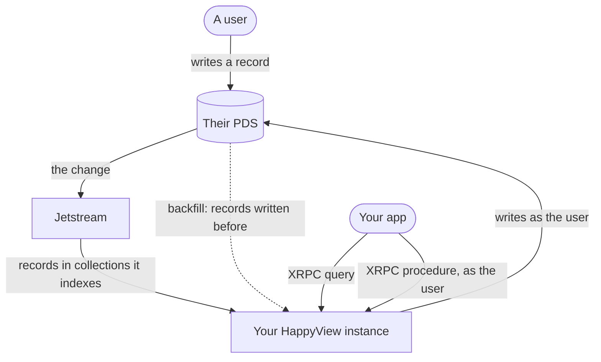

HappyView is an AppView: it reads records from the atproto network, keeps the ones your app cares about, and answers your app's questions about them. This page names the atproto pieces the rest of Getting started uses. You don't need more than this to build with HappyView.

## The pieces

- **DID**: A permanent id for an account, such as `did:plc:ewvi7nxzyoun6zhxrhs64oiz`. A handle like `alice.bsky.social` (an account's username, not the `handle` function scripts define) points to one.
- **PDS**: The server that holds an account's data (its Personal Data Server). Every write to an account goes to its PDS.
- **Repository**: An account's data on its PDS: a set of records, each with a URI such as `at://did:plc:…/xyz.statusphere.status/3l2k…`.
- **Record**: One piece of data in a repository, such as a status, a post or a like. Its shape is set by a lexicon.
- **Lexicon**: A schema document. A record lexicon describes a kind of record; a query or procedure lexicon describes an endpoint.
- **NSID**: A lexicon's id, written as a reversed domain plus a name: `xyz.statusphere.status`.
- **Collection**: All the records of one record lexicon, named by its NSID. HappyView indexes collections.
- **XRPC**: atproto's HTTP API style. An endpoint is called at `/xrpc/<NSID>`: a **query** with `GET`, a **procedure**, which changes something, with `POST`.
- **Jetstream**: A live feed of record changes across the network, filtered by collection. HappyView listens to it for the collections it indexes.
- **AppView**: A service that indexes records from many repositories and answers queries about them. A HappyView instance is one.
- **DPoP**: A way of tying a user's sign-in tokens to a key the app holds, so a stolen token alone is useless. Your app's users sign in to HappyView with it.

## How a record reaches your app

1. A user writes a record to their PDS, through your app or any other.
2. Jetstream carries the change, and your instance keeps it if it indexes that collection. Records written before your instance started indexing come in by **backfill**, fetched from each PDS.
3. Your app calls a **query** on your instance, and gets answers from the instance's index.
4. Your app calls a **procedure** to change something. The instance writes to the user's PDS as that user, and indexes the result straight away.

Your project decides each step: which collections are indexed, what each query returns, and what a procedure writes. That is what the rest of Getting started builds.

## Next steps

- [Installation](/docs/getting-started/installation): install `hpy` and create a project.
- [Glossary](/docs/architecture/glossary): every term HappyView uses.
