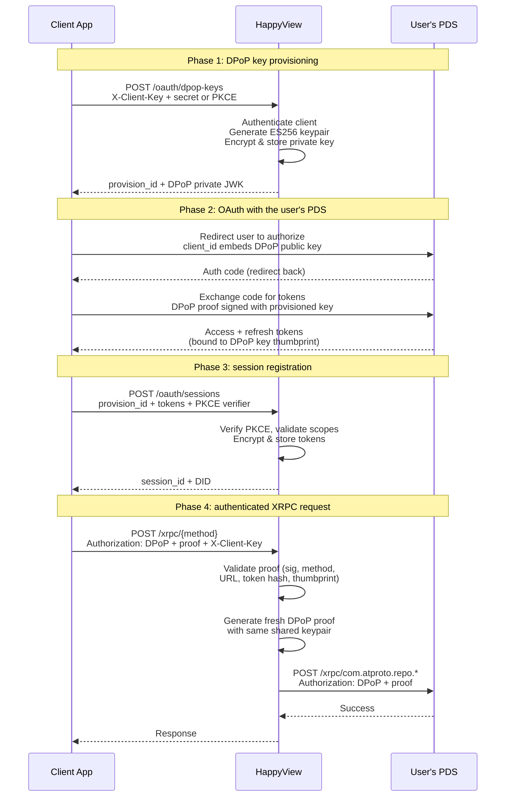

import { Tabs, TabItem } from '@astrojs/starlight/components';

HappyView has two authentication surfaces:

- **XRPC** (`/xrpc/*`): client-level identification with an API client key, plus user-level atproto OAuth for endpoints that need a specific user's identity, such as procedures that write to a PDS.
- **Admin API** (`/admin/*`): operator-level authentication with an admin API key, a dashboard session or an app's granted session, gated by [permissions](/docs/guides/permissions).

## Requirements by endpoint

| Endpoint type                      | Client identification   | User authentication                                                                                 |
| ---------------------------------- | ----------------------- | --------------------------------------------------------------------------------------------------- |
| Queries (`GET /xrpc/{method}`)     | `X-Client-Key` recommended, required with DPoP auth or a dashboard session | Optional: DPoP auth if the query needs to know who the user is |
| Procedures (`POST /xrpc/{method}`) | `X-Client-Key` required, except with a service auth JWT or a space credential | Required: DPoP auth so HappyView can proxy writes to the user's PDS |
| Admin API (`/admin/*`)             | none | Required: an admin API key, a dashboard session or an app's granted session, with the right [permissions](/docs/guides/permissions) |
| Health check (`GET /health`)       | none | none |

## XRPC: API client identification

An XRPC request identifies itself with a registered API client. The client key identifies which app is calling. It also selects the rate-limit bucket, but only for a request proven to come from that app. An authenticated request without one returns `401 Unauthorized`: a DPoP request with `DPoP auth requires X-Client-Key header`, a dashboard session with `Missing client identification`. An anonymous query without one still runs, and every such request shares one `anonymous` rate-limit bucket.

Register a client in the dashboard (**Access > API Clients**, then **Create API Client**) or via `POST /admin/api-clients`. The response contains an `hvc_…` client key and, for a confidential client, an `hvs_…` client secret. A public client has no secret. The secret is shown only once.

HappyView resolves the client key from the first of:

1. The session the request authenticated with: a DPoP session, or the dashboard's session.
2. The `X-Client-Key` request header.
3. A `client_key` query-string parameter.

The client key is public, so naming one doesn't prove the request comes from that client. A request is charged to the client's rate-limit bucket only when it proves it is that client, in one of three ways:

- Its session: a DPoP session, or the dashboard's session, registered under that client.
- An `Origin` header matching the client's registered `client_uri` (typical for browser apps).
- With no `Origin` header, an `X-Client-Secret` header matching one of the client's secrets that hasn't been revoked (typical for server-to-server callers).

A request that names a key HappyView doesn't know, sends an `Origin` that doesn't match, sends a wrong secret, or sends neither isn't rejected. HappyView logs a warning and rate limits it as an anonymous request, so it is never charged to the named client's bucket.

A client secret is a credential. Do not share it.

### Calling a query

<Tabs syncKey="lang">
<TabItem label="TypeScript">

```ts
const CLIENT_KEY = "hvc_a1b2c3..."; // your API client key

const response = await fetch(
  "https://happyview.example.com/xrpc/com.example.feed.getHot",
  { headers: { "X-Client-Key": CLIENT_KEY } },
);
```

</TabItem>
<TabItem label="JavaScript">

```js
const CLIENT_KEY = "hvc_a1b2c3..."; // your API client key

const response = await fetch(
  "https://happyview.example.com/xrpc/com.example.feed.getHot",
  { headers: { "X-Client-Key": CLIENT_KEY } },
);
```

</TabItem>
<TabItem label="Rust">

```rust
let client = reqwest::Client::new();
let client_key = "hvc_a1b2c3..."; // your API client key

let response = client
    .get("https://happyview.example.com/xrpc/com.example.feed.getHot")
    .header("X-Client-Key", client_key)
    .send()
    .await?;
```

</TabItem>
<TabItem label="Go">

```go
clientKey := "hvc_a1b2c3..." // your API client key

req, _ := http.NewRequest("GET",
  "https://happyview.example.com/xrpc/com.example.feed.getHot", nil)
req.Header.Set("X-Client-Key", clientKey)

resp, err := http.DefaultClient.Do(req)
if err != nil {
  log.Fatal(err)
}
defer resp.Body.Close()
```

</TabItem>
<TabItem label="cURL">

```sh
curl 'https://happyview.example.com/xrpc/com.example.feed.getHot' \
  -H 'X-Client-Key: hvc_a1b2c3...'
```

</TabItem>
</Tabs>

For a server-to-server integration, add the secret:

<Tabs syncKey="lang">
<TabItem label="TypeScript">

```ts
const response = await fetch(
  "https://happyview.example.com/xrpc/com.example.feed.getHot",
  {
    headers: {
      "X-Client-Key": "hvc_a1b2c3...",
      "X-Client-Secret": "hvs_d4e5f6...",
    },
  },
);
```

</TabItem>
<TabItem label="JavaScript">

```js
const response = await fetch(
  "https://happyview.example.com/xrpc/com.example.feed.getHot",
  {
    headers: {
      "X-Client-Key": "hvc_a1b2c3...",
      "X-Client-Secret": "hvs_d4e5f6...",
    },
  },
);
```

</TabItem>
<TabItem label="Rust">

```rust
let client_secret = "hvs_d4e5f6..."; // your API client secret

let response = client
    .get("https://happyview.example.com/xrpc/com.example.feed.getHot")
    .header("X-Client-Key", client_key)
    .header("X-Client-Secret", client_secret)
    .send()
    .await?;
```

</TabItem>
<TabItem label="Go">

```go
clientKey := "hvc_a1b2c3..."    // your API client key
clientSecret := "hvs_d4e5f6..." // your API client secret

req, _ := http.NewRequest("GET",
  "https://happyview.example.com/xrpc/com.example.feed.getHot", nil)
req.Header.Set("X-Client-Key", clientKey)
req.Header.Set("X-Client-Secret", clientSecret)

resp, err := http.DefaultClient.Do(req)
if err != nil {
  log.Fatal(err)
}
defer resp.Body.Close()
```

</TabItem>
<TabItem label="cURL">

```sh
curl 'https://happyview.example.com/xrpc/com.example.feed.getHot' \
  -H 'X-Client-Key: hvc_a1b2c3...' \
  -H 'X-Client-Secret: hvs_d4e5f6...'
```

</TabItem>
</Tabs>

### Authenticating users for procedures

A query that does not use the caller's identity needs no user authentication. Procedures, and queries whose scripts read the caller's DID, need an atproto OAuth session.

XRPC routes accept several auth methods, resolved in this order:

1. **DPoP auth** (`Authorization: DPoP <token>`, a `DPoP` proof header and `X-Client-Key`), used by third-party apps that went through the [DPoP key provisioning](#dpop-key-provisioning-for-third-party-apps) flow.
2. **Bearer service auth JWT** (`Authorization: Bearer <service_auth_jwt>`), a standard atproto inter-service JWT. See [Service auth JWT](#service-auth-jwt).
3. **Space credential** (`Authorization: Atproto-Space <credential>`), a signed JWT granting read access to a specific atproto space, sent with an `Atproto-Space-Audience` header and an HTTP Message Signature by the key the credential is bound to. Accepted on atproto space routes. See [Space credentials](/docs/guides/spaces/credentials).
4. **Cookie session**. When no `Authorization` header is present, HappyView falls back to the signed session cookie set after dashboard login, on a request from the instance's own pages only.
5. **Anonymous**. If none of the above is present, the request proceeds with no identity. The endpoint's script determines whether that is acceptable.

Bearer API keys (`hv_*`) aren't accepted on XRPC endpoints. They are for admin API access only.

Third-party apps authenticate users through the [DPoP key provisioning](#dpop-key-provisioning-for-third-party-apps) flow.

The [JavaScript SDK](/docs/reference/sdk) implements this flow:

```typescript
import { Client } from "@atproto/lex";
import { HappyViewBrowserClient } from "@happyview/oauth-client-browser";
import { createAgent } from "@happyview/lex-agent";

const oauthClient = new HappyViewBrowserClient({
  instanceUrl: "https://happyview.example.com",
  clientId: "https://myapp.example.com/oauth-client-metadata.json",
  clientKey: "hvc_your_client_key",
});

// Sign in: redirects to the user's PDS for authorization
await oauthClient.signIn("alice.bsky.social");

// On page load: restore a session or process the OAuth callback
const result = await oauthClient.init();

if (result) {
  // Create a type-safe Lex client
  const agent = createAgent(result.session);
  const lex = new Client(agent);

  // Make authenticated XRPC calls
  await lex.xrpc(myLexicons.com.example.createPost, {
    input: { text: "Hello from HappyView!" },
  });
}
```

For procedures, HappyView proxies the write to the user's PDS using the stored OAuth session. See [Proxying procedures](#proxying-procedures-to-the-users-pds) below.

### Service auth JWT

XRPC routes accept standard atproto inter-service auth JWTs in the `Authorization` header. A service signs a short-lived ES256 or ES256K JWT with its DID's signing key. HappyView resolves the issuer's DID document, verifies the signature against the `#atproto` verification method, and treats the issuer DID as the caller.

For a service auth JWT to validate:

- `alg` must be `ES256` or `ES256K`.
- `typ` must not be `at+jwt`, `refresh+jwt` or `dpop+jwt`, which are other token types.
- `aud` must start with this instance's DID. The fragment after it names the [service entry](/docs/reference/admin/service-entries) the token is for, and that entry must be allowed to call the method. An atproto space route also accepts the bare DID.
- `exp` must be in the future, and at most an hour away.
- `lxm`, when present, must name the method being called.
- The signature must verify against the issuer DID's atproto signing key.

The instance needs a [service identity](/docs/guides/service-identity) with a DID to accept one. With none, or with a service identity that isn't exposed, every service auth JWT is refused.

## Admin API: user authentication

Admin endpoints don't use API clients. They require an operator, identified by one of three methods:

- An [admin API key](#admin-api-key), for automation.
- The dashboard's session cookie, after signing in.
- An app's DPoP session the user granted [`dev.happyview.adminFull`](#apps-and-the-admin-api).

### Admin API key

For automation such as CI/CD, monitoring and cron jobs, create an [admin API key](/docs/guides/api-keys) at **Access > API Keys** or via `POST /admin/api-keys` and pass it as a bearer token:

<Tabs syncKey="lang">
<TabItem label="TypeScript">

```ts
const TOKEN = "hv_your-api-key-here";

const response = await fetch("http://127.0.0.1:3000/admin/lexicons", {
  headers: { Authorization: `Bearer ${TOKEN}` },
});
```

</TabItem>
<TabItem label="JavaScript">

```js
const TOKEN = "hv_your-api-key-here";

const response = await fetch("http://127.0.0.1:3000/admin/lexicons", {
  headers: { Authorization: `Bearer ${TOKEN}` },
});
```

</TabItem>
<TabItem label="Rust">

```rust
let token = "hv_your-api-key-here";

let response = client
    .get("http://127.0.0.1:3000/admin/lexicons")
    .bearer_auth(token)
    .send()
    .await?;
```

</TabItem>
<TabItem label="Go">

```go
token := "hv_your-api-key-here"

req, _ := http.NewRequest("GET", "http://127.0.0.1:3000/admin/lexicons", nil)
req.Header.Set("Authorization", "Bearer "+token)

resp, err := http.DefaultClient.Do(req)
if err != nil {
  log.Fatal(err)
}
defer resp.Body.Close()
```

</TabItem>
<TabItem label="cURL">

```sh
export TOKEN="hv_your-api-key-here"
curl http://127.0.0.1:3000/admin/lexicons \
  -H "Authorization: Bearer $TOKEN"
```

</TabItem>
</Tabs>

A key only carries the permissions selected at creation time and can never exceed the permissions of the operator who created it.

### Apps and the admin API

An app's DPoP session reaches `/admin` only when the user approved the permission set `dev.happyview.adminFull` at sign-in, by the app asking for `include:dev.happyview.adminFull`. HappyView reads what was granted from the user's authorization server, never from the app, and re-reads it once the access token lapses, so a grant revoked at the PDS stops counting within one token lifetime. The resolved DID still has to be an operator with the right [permissions](/docs/guides/permissions).

The admin API refuses every service auth JWT, with `403`.

### Admin access and the first user

On a new instance, the `happyview_users` table is empty. The first authenticated request to any admin endpoint makes that person an operator with the superadmin privilege and every permission. This includes signing in to the dashboard, which makes admin API calls for the signed-in user, so the first user to sign in becomes that operator.

When [`SUPERADMIN_DID`](/docs/reference/configuration#secrets-and-sign-in) is set, this does not happen: that DID is given the privilege at boot, and signing in first confers nothing.

To add more operators after that, use `POST /admin/users` or the [dashboard](/docs/guides/dashboard). Permissions are assigned individually or from a template (`viewer`, `maintainer`, `manager`, `full_access`). See [Users](/docs/reference/admin/users) for details.

## Proxying procedures to the user's PDS

When an app calls an XRPC procedure that writes a record, HappyView proxies the write to the user's PDS. This requires a DPoP-authenticated session: the app must have gone through the [DPoP key provisioning](#dpop-key-provisioning-for-third-party-apps) flow and registered tokens for the user. HappyView uses the app's provisioned DPoP key to generate fresh proofs and attach the stored access token to the outbound PDS request.

A request that only carries an `X-Client-Key` header, with no DPoP token, can call queries but can't proxy writes, because there's no user to write as.

## DPoP key provisioning for third-party apps

Third-party apps that want HappyView to make PDS writes on behalf of their users use the **DPoP key provisioning** flow. The flow uses no browser redirect through HappyView's domain, so browser bounce-tracking protections, such as Firefox's, do not affect it.

For each device, the app gets a DPoP keypair from HappyView, uses that keypair during its own OAuth flow with the user's PDS, then registers the resulting tokens back with HappyView. Each device gets its own keypair and session, so a user can be signed in on multiple devices simultaneously. From that point on, XRPC requests authenticated with `Authorization: DPoP <access_token>` plus a `DPoP` proof header and `X-Client-Key` will have HappyView proxy writes using the stored session that matches the request's DPoP key.

The app and HappyView share the same DPoP keypair, so both can generate valid proofs that the PDS will accept. The PDS binds tokens to a key's thumbprint and checks only that the right key signed the proof.

### Flow overview



:::tip
The [JavaScript SDK](/docs/reference/sdk) implements this flow. The HTTP flow below is for apps in other languages, and for reference.
:::

### API clients: confidential vs public

API clients have a `client_type` field, either `confidential` (default) or `public`.

- **Confidential clients** authenticate with `X-Client-Key` + `X-Client-Secret` headers. Once a session is registered, the session endpoints also accept a DPoP proof instead (see [Logout](#5-logout)).
- **Public clients** (browser apps that can't keep a secret) authenticate with `X-Client-Key` header + PKCE. The app sends a `pkce_challenge` (S256) in the body when provisioning a key, then proves possession with `pkce_verifier` when registering a session. When a public client has `allowed_origins`, the `Origin` header on `POST /oauth/dpop-keys` must be one of them.

### The full flow

#### 1. Provision a DPoP key

```
POST /oauth/dpop-keys
X-Client-Key: hvc_...
X-Client-Secret: hvs_...
Content-Type: application/json

{}
```

For public clients, omit `X-Client-Secret` and include the PKCE challenge in the body:

```
POST /oauth/dpop-keys
X-Client-Key: hvc_...
Origin: http://127.0.0.1:3000
Content-Type: application/json

{ "pkce_challenge": "base64url..." }
```

| Field | Type | Required | Meaning |
| --- | --- | --- | --- |
| `pkce_challenge` | string (base64url, S256) | if the request has no `X-Client-Secret` | The challenge `pkce_verifier` answers when the session is registered. |

Response: `201 Created`

```json
{
  "provision_id": "hvp_...",
  "dpop_key": {
    "kty": "EC",
    "crv": "P-256",
    "x": "...",
    "y": "...",
    "d": "..."
  },
  "confidential": false
}
```

The `dpop_key` is the private JWK. Use it to generate DPoP proofs during your OAuth flow with the user's PDS. `confidential` says whether the app has to authenticate to the PDS with a client assertion.

#### 2. Run OAuth with the user's PDS

Use the provisioned DPoP key as your DPoP keypair in a standard atproto OAuth flow with the user's PDS. HappyView is not involved in this step: the app talks directly to the PDS authorization server.

#### 3. Register the session

After the OAuth callback, register the token set with HappyView:

```
POST /oauth/sessions
X-Client-Key: hvc_...
X-Client-Secret: hvs_...
Content-Type: application/json

{
  "provision_id": "hvp_...",
  "did": "did:plc:user123",
  "access_token": "...",
  "refresh_token": "...",
  "expires_at": "2026-04-17T00:00:00Z",
  "scopes": "atproto transition:generic",
  "pds_url": "https://bsky.social",
  "issuer": "https://bsky.social"
}
```

For public clients, omit `X-Client-Secret` and include the PKCE verifier in the body:

```json
{
  "provision_id": "hvp_...",
  "pkce_verifier": "...",
  "did": "did:plc:user123",
  "access_token": "...",
  "refresh_token": "...",
  "expires_at": "2026-04-17T00:00:00Z",
  "scopes": "atproto transition:generic",
  "pds_url": "https://bsky.social",
  "issuer": "https://bsky.social"
}
```

| Field | Type | Required | Meaning |
| --- | --- | --- | --- |
| `provision_id` | string | yes | From step 1. |
| `pkce_verifier` | string | if the request has no `X-Client-Secret` | Answers the `pkce_challenge` from step 1. |
| `did` | string (DID) | yes | The user. HappyView checks that the access token belongs to this DID. |
| `access_token` | string | yes | From the PDS. |
| `refresh_token` | string | no | From the PDS. |
| `expires_at` | string (date-time) | no | When the access token expires. |
| `scopes` | string | yes | Space-separated scopes the PDS granted. |
| `pds_url` | string (URL) | no | Ignored. HappyView sends the session's requests to the PDS named in the user's DID document, the one it checked the access token with. |
| `issuer` | string (URL) | no | The authorization server that issued the tokens. The user's PDS must list it in `/.well-known/oauth-protected-resource`, and its metadata must give the same `issuer`, or the registration answers `403`. Without it, the session can't be refreshed or revoked. |
| `signing_kid` | string | no | The key that signed the token exchange's client assertion. Default: the key the provision's assertions used, else the client's current one. |

Response: `201 Created`

```json
{
  "session_id": "uuid",
  "did": "did:plc:user123",
  "scopes": ["atproto", "transition:generic"]
}
```

`GET /oauth/sessions/{did}` returns `{ did, scopes }` for the session, authenticated as logout below is.

#### 4. Make XRPC requests

With a registered session, send XRPC requests using DPoP auth:

<Tabs syncKey="lang">
<TabItem label="TypeScript">

```ts
const CLIENT_KEY = "hvc_..."; // your API client key
const ACCESS_TOKEN = "..."; // DPoP access token
const DPOP_PROOF = "..."; // DPoP proof JWT

const response = await fetch(
  "https://happyview.example.com/xrpc/com.example.feed.createPost",
  {
    method: "POST",
    headers: {
      "X-Client-Key": CLIENT_KEY,
      Authorization: `DPoP ${ACCESS_TOKEN}`,
      DPoP: DPOP_PROOF,
      "Content-Type": "application/json",
    },
    body: JSON.stringify({ text: "Hello world" }),
  },
);
```

</TabItem>
<TabItem label="JavaScript">

```js
const CLIENT_KEY = "hvc_..."; // your API client key
const ACCESS_TOKEN = "..."; // DPoP access token
const DPOP_PROOF = "..."; // DPoP proof JWT

const response = await fetch(
  "https://happyview.example.com/xrpc/com.example.feed.createPost",
  {
    method: "POST",
    headers: {
      "X-Client-Key": CLIENT_KEY,
      Authorization: `DPoP ${ACCESS_TOKEN}`,
      DPoP: DPOP_PROOF,
      "Content-Type": "application/json",
    },
    body: JSON.stringify({ text: "Hello world" }),
  },
);
```

</TabItem>
<TabItem label="Rust">

```rust
let client_key = "hvc_..."; // your API client key
let access_token = "..."; // DPoP access token
let dpop_proof = "..."; // DPoP proof JWT

let response = client
    .post("https://happyview.example.com/xrpc/com.example.feed.createPost")
    .header("X-Client-Key", client_key)
    .header("Authorization", format!("DPoP {}", access_token))
    .header("DPoP", dpop_proof)
    .json(&serde_json::json!({ "text": "Hello world" }))
    .send()
    .await?;
```

</TabItem>
<TabItem label="Go">

```go
clientKey := "hvc_..."  // your API client key
accessToken := "..."    // DPoP access token
dpopProof := "..."      // DPoP proof JWT

body := bytes.NewBufferString(`{"text": "Hello world"}`)

req, _ := http.NewRequest("POST",
  "https://happyview.example.com/xrpc/com.example.feed.createPost", body)
req.Header.Set("X-Client-Key", clientKey)
req.Header.Set("Authorization", "DPoP "+accessToken)
req.Header.Set("DPoP", dpopProof)
req.Header.Set("Content-Type", "application/json")

resp, err := http.DefaultClient.Do(req)
if err != nil {
  log.Fatal(err)
}
defer resp.Body.Close()
```

</TabItem>
<TabItem label="cURL">

```sh
curl -X POST 'https://happyview.example.com/xrpc/com.example.feed.createPost' \
  -H 'X-Client-Key: hvc_...' \
  -H 'Authorization: DPoP <access_token>' \
  -H 'DPoP: <proof_jwt>' \
  -H 'Content-Type: application/json' \
  -d '{"text": "Hello world"}'
```

</TabItem>
</Tabs>

HappyView validates the DPoP proof, looks up the stored session, and proxies the write to the user's PDS using the provisioned DPoP key to generate a fresh proof.

#### 5. Logout

Confidential clients authenticate with `X-Client-Key` + `X-Client-Secret`, and the request revokes all device sessions for the user under this client, for a full sign-out:

```
DELETE /oauth/sessions/did:plc:user123
X-Client-Key: hvc_...
X-Client-Secret: hvs_...
```

Alternatively, provide a valid DPoP proof to prove you hold the key. A request authenticated this way revokes only the session that matches the DPoP key used in the proof, and other device sessions for the same user are unaffected:

```
DELETE /oauth/sessions/did:plc:user123
X-Client-Key: hvc_...
Authorization: DPoP <access_token>
DPoP: <proof_jwt>
```

DPoP auth is accepted here from any client, confidential or public, as on `/xrpc/*` calls.

Either way, HappyView revokes the session at the user's authorization server before deleting it, and returns `204 No Content`. Revocation is best effort: a PDS that is down can't make a logout fail.

The `htu` in the proof must match the URL you requested, byte for byte. If you percent-encode the DID in the path, sign the encoded form.

To revoke a specific device session (for either client type), use the [device management endpoints](#6-managing-device-sessions) instead.

#### 6. Managing device sessions

When an app registers sessions for one user from multiple devices (each with its own DPoP keypair), HappyView tracks each session separately. You can list and revoke individual device sessions without affecting the others.

Confidential clients authenticate with `X-Client-Key` + `X-Client-Secret`. Any client can authenticate with a DPoP proof instead, as on logout.

To list a user's device sessions:

```
GET /oauth/sessions/did:plc:user123/devices
X-Client-Key: hvc_...
X-Client-Secret: hvs_...
```

Response:

```json
[
  {
    "id": "uuid-session-1",
    "dpop_key_id": "uuid-key-1",
    "scopes": ["atproto", "transition:generic"],
    "created_at": "2026-05-20T12:00:00Z",
    "updated_at": "2026-05-20T12:00:00Z"
  },
  {
    "id": "uuid-session-2",
    "dpop_key_id": "uuid-key-2",
    "scopes": ["atproto", "transition:generic"],
    "created_at": "2026-05-21T08:30:00Z",
    "updated_at": "2026-05-21T08:30:00Z"
  }
]
```

To delete one device session:

```
DELETE /oauth/sessions/did:plc:user123/devices/uuid-session-1
X-Client-Key: hvc_...
X-Client-Secret: hvs_...
```

Or use DPoP auth instead of `X-Client-Secret`, from any client type:

```
DELETE /oauth/sessions/did:plc:user123/devices/uuid-session-1
X-Client-Key: hvc_...
Authorization: DPoP <access_token>
DPoP: <proof_jwt>
```

Returns `204 No Content` on success, `404 Not Found` if the session doesn't exist or doesn't belong to the client/user.

### Security notes

- Private keys and tokens are encrypted at rest with AES-256-GCM using `TOKEN_ENCRYPTION_KEY`.
- DPoP proofs are validated for method, URL, timestamp (5-minute window), access token binding, and JWK thumbprint.
- Scopes requested must include `atproto` and must be a subset of the API client's registered scopes.

## Next steps

- [JavaScript SDK](/docs/reference/sdk): authenticate and make XRPC calls from JavaScript
- [Permissions](/docs/guides/permissions): full list of permissions and what each one grants
- [API keys](/docs/guides/api-keys): create scoped admin API keys for automation
- [Admin API: API clients](/docs/reference/admin/api-clients): register API clients and configure rate limits
- [Third-party API clients](/docs/reference/oauth): let third-party apps manage their own API clients programmatically
